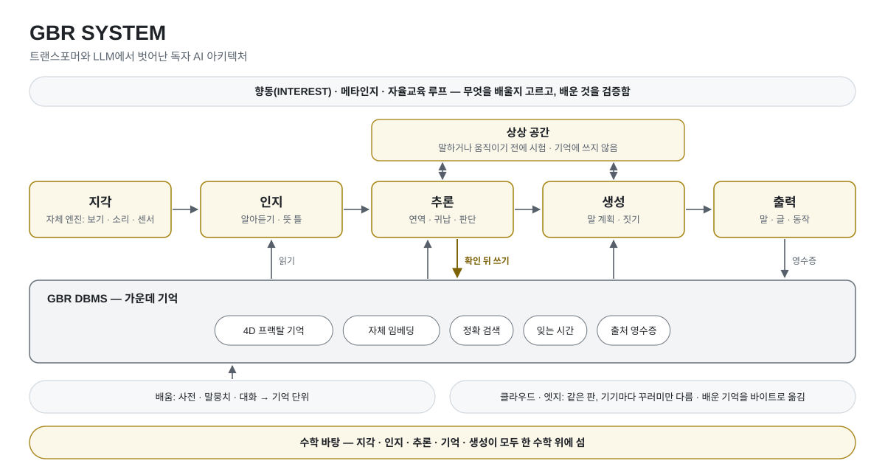

# GBR

## 트랜스포머와 LLM에서 벗어난 독자 AI 아키텍처

[English](README_EN.md)

GBR SYSTEM은 트랜스포머 구조와 LLM에서 벗어나 독자적으로 설계한 AI 아키텍처입니다.

GBR 추론 엔진은 초고난도 스도쿠 데이터셋 Sudoku-Extreme의 공개 시험 묶음에서, 결과를 보기 전에 정한 규칙으로 뽑은 1만 판을 모두 풀었습니다(10,000 / 10,000 · 틀린 답 0). 판 규칙은 훈련 묶음의 정답 예시에서 세어 썼고(훈련 묶음 앞 정답 81개면 표준 규칙과 같아집니다), 추측과 되돌림 없이 판마다 한 번에 풀었습니다. 이 데이터셋 밖의 표준 스도쿠 726판도 모두 풀었습니다. 판마다 정답 확인 증명서와 검사기를 이 저장소에 공개합니다.

- GBR은 기억을 근거로 연역과 귀납으로 추론합니다. 말하거나 움직이기 전에 상상 공간에서 먼저 시험하고, 근거가 있으면 답하고, 갈리면 되묻고, 없으면 모른다고 말합니다.
- 지각 · 인지 · 추론 · 기억 · 생성이 모두 하나의 새로운 수학 프레임워크 위에 섭니다. 이산적인 갱신과 변분 연산에서 생기는 고질적인 문제를 풀려고 만든 독자 수학입니다.
- 기억은 자체 DBMS 위의 4D 프랙탈 기억입니다. 같은 꼴이 기억 하나에서 묶음, 윗묶음까지 크기마다 되풀이되어, 기억이 늘어도 필요한 부분만 정확히 찾아 읽습니다. 임베딩도 바깥 것을 빌리지 않고 자체로 지었습니다.
- OpenCV 같은 외부 라이브러리를 쓰지 않는 자체 지각 엔진과, 판단 · 생성 엔진을 구현했습니다.
- 향동(INTEREST)이라 이름 붙인 능동 기반과 메타인지, 자율교육 루프를 설계해 개발하고 있습니다.

GBR은 적은 전력과 낮은 컴퓨팅 사양에서도 작동합니다. 현재 메모리 8 GB인 NVIDIA Jetson Orin Nano Super 한 대에서 외부 서버 없이 작동을 확인하였습니다. 시연 영상은 [YouTube](https://youtu.be/3SpQAy4sbB0)에서 보실 수 있습니다.

GBR은 아직 개발 중입니다. 배운 데이터가 아직 많지 않아 LLM만큼 유창하거나 놀라운 생성은 어렵지만, 확실히 작동합니다. 한국에서 만들고 있어서 지금은 숫자와 한국어만 배웠습니다.

GBR은 기존 아키텍처나 외부 자원에 종속되지 않는 소버린 AI를 지향합니다.

## 아키텍처

<picture>
  <source media="(prefers-color-scheme: dark)" srcset="figs/gbr-architecture-ko-dark.svg">
  
</picture>

| | 가중치 기반 언어모델 | GBR |
|---|---|---|
| 추론 | 다음 토큰을 이어 쓰며 추론 | 기억을 근거로 연역 · 귀납 추론, 답하기 전에 시험 |
| 지식 저장 위치 | 학습된 가중치에 분산 | 버전 관리되는 기억 단위 |
| 스텝별 상태 | 대화와 함께 커지는 컨텍스트 윈도우(한도까지) | 고정 크기 대화 상태 + 필요할 때 찾아 읽는 기억 |
| 배운 결과의 반영 · 수정 | 재학습 · 파인튜닝 | 기억 단위의 게시 · 정정 · 철회 |

## 스도쿠 풀이 결과

GBR 추론 엔진이 푼 스도쿠 결과와 증명 자료입니다. 추론 엔진을 직접 돌린 결과이며, 시스템 전체 경로로 낸 점수는 아닙니다.

| 항목 | 내용 |
|---|---|
| 데이터셋 | Hugging Face `sapientinc/sudoku-extreme`의 test 묶음(422,786판) |
| 뽑은 판 | 결과를 보기 전에 정한 규칙(판 번호의 해시 차례)으로 뽑은 10,000판 · 규칙과 판 목록은 [`results/sudoku/`](results/sudoku/README.md) |
| 조건 | GBR 추론 엔진을 직접 돌림 · 판마다 한 번 · 추측과 되돌림 없음(어떤 후보도 맞다고 가정한 채 풀이를 이어 가지 않음). 풀이 과정 증명서 1만 개는 독립 검사기와 drat-trim으로 안에서 확인했고, 공개하지 않습니다. |
| 판 규칙 | 판 규칙(어느 칸끼리 같은 숫자가 올 수 없는지)은 훈련 묶음(`train.csv`)의 정답 예시에서 셉니다. 훈련 묶음 앞 정답 81개면 센 규칙이 표준 규칙과 같아지고, 공개 길은 센 규칙이 표준 규칙과 같은지 맞대어 다르면 풀지 않습니다. 센 규칙으로 1만 판을 다시 풀어 답과 증명서가 바이트까지 같음을 확인했습니다. 표준 9×9에만 해당합니다. |
| 결과 | 10,000 / 10,000 · 틀린 답 0 · 개발 중 본 적 없는 판 7,379 / 7,379 · 난이도 띠마다 모두 풀림(가장 어려운 띠 115판은 모두 개발 중에 본 판) · 띠별 표는 [`results/sudoku/`](results/sudoku/README.md) |
| 시스템 경로 맞댐 | 같은 목록 앞 100판은 시스템 전체 경로로도 풀어, 추론 엔진과 같은 답이 나옴을 확인 |
| 데이터셋 밖 판 | 공개 목록 넷에서 결과를 보기 전에 정한 규칙으로 고른 표준 9×9 726판을 같은 엔진 · 같은 조건으로 풀었습니다. 726 / 726 풀렸고, 증명서도 검사기와 drat-trim으로 모두 확인됐습니다. 이 가운데 데이터셋과 글자 · 대칭까지 맞대어 데이터셋 밖으로 확인된 611판은 611 / 611입니다(AI Escargot 포함). 증명서는 누구나 다시 확인할 수 있고, 같은 엔진 · 같은 조건으로 풀었다는 것은 안에서 확인했습니다. 표와 증명서는 [`results/sudoku/outside_dataset_726/`](results/sudoku/outside_dataset_726/) |
| 증명 자료 | 판마다 정답 확인 증명서를 [`results/sudoku/certificates/`](results/sudoku/certificates/)에 실었습니다. 각 증명서는 그 답이 유일한 해임을 보입니다(표준 스도쿠 CNF + RUP 보조 절 · DRAT 글). 증명서를 짓는 공개 증명기에는 문제와 GBR 추론 엔진이 낸 답만 넣고, 검사기가 데이터셋 정답과 맞댑니다. 누구나 돌릴 수 있는 범용 검사기는 [`results/sudoku/verify/sudoku-rup-check/`](results/sudoku/verify/sudoku-rup-check/), 공개 증명기 소스는 [`results/sudoku/verify/sudoku-rup-prover/`](results/sudoku/verify/sudoku-rup-prover/)에 있습니다. 바깥 검사기 drat-trim(공개 원천 커밋 2e3b2dc0)으로도 1만 판 모두 확인했습니다(VERIFIED 10,000 · NOT VERIFIED 0). 판마다 정답 해시로 데이터셋 정답과 맞대어 볼 수 있습니다. |
| 문제별 결과 | [`results/sudoku/`](results/sudoku/README.md)(결과표에는 문제 글과 격자를 싣지 않음) |

### 실험 환경

| 항목 | 내용 |
|---|---|
| 장비 | 데스크톱급 PC 한 대 — Intel Core i5-13500(14코어 · 20스레드) · 메모리 64 GB · NVMe SSD |
| GPU | 쓰지 않음(CPU만) |
| 운영체제 | Ubuntu 24.04 LTS |
| 풀이 | GBR 추론 엔진 · 판마다 한 번 · 동시에 10판씩 · 1만 판 1시간 56분(6,939초) · 풀이 프로세스 하나 최대 메모리 약 2.1 GB |
| 검사 | 증명서 짓기 1만 판 159초(16묶음 동시) · 공개 검사기(Rust 1.96 · 표준 라이브러리만) 1만 판 10.6초 · 외부 검사기 drat-trim(공개 원천 커밋 2e3b2dc0 · gcc 13.3) 1만 판 88초(16개 동시) |
| 데이터 | `sapientinc/sudoku-extreme` test.csv(sha256 `a2fd52aea23d331d5b4ee723c856236e838a9fb9a70e66f4e0e0cf26c338c6a8`) |

직접 확인하기(검사기를 지으려면 Rust 1.85 이상이 필요합니다 · 우리는 1.96으로 지었습니다):

```bash
cd results/sudoku
# 데이터셋(sapientinc/sudoku-extreme)의 test 파일을 내려받아 sha256을 맞대 봅니다(79,360,390바이트)
curl -L -o test.csv https://huggingface.co/datasets/sapientinc/sudoku-extreme/resolve/main/test.csv
echo "a2fd52aea23d331d5b4ee723c856236e838a9fb9a70e66f4e0e0cf26c338c6a8  test.csv" | sha256sum -c
cargo build --release --manifest-path verify/sudoku-rup-check/Cargo.toml
mkdir certs && tar -xzf certificates/sudoku_10k_certificates.tar.gz -C certs
verify/sudoku-rup-check/target/release/sudoku-rup-check dataset test.csv certs/proofs
# 검사기는 있는 증명서 파일만 셉니다 — 끝 줄이 TOTAL boards=10000 verified=10000 open=0 failed=0인지 보세요
```

> 결과: 10,000 / 10,000 · 틀린 답 0 · 정답 확인 증명서 10,000개 모두 검사기 통과(바깥 검사기 drat-trim으로도 모두 확인) · 개발 중 본 적 없는 판 7,379 / 7,379 · 데이터셋 밖 표준 판 726 / 726(데이터셋 밖으로 확인된 611 / 611). 추론 엔진을 직접 돌린 결과이며, 시스템 전체 경로 점수는 아닙니다.

참고: HRM 논문(arXiv:2506.21734, 2025년)은 Sudoku-Extreme에서 당시 최고 수준의 사고 사슬(CoT) 방식들이 「완전히 실패(정확도 0%)」했다고 적습니다.

## 라이선스

이 저장소는 [Apache License 2.0](LICENSE)을 따릅니다. 다만 검사기 · 증명기의 시험 파일에 실은 널리 알려진 스도쿠 판 몇 개는 각 출처의 것입니다.

## 더 보기

- 시연 영상: [YouTube](https://youtu.be/3SpQAy4sbB0)
- 웹사이트: [zigulabs.com](https://www.zigulabs.com)
- 문의: [agent@zigulabs.com](mailto:agent@zigulabs.com)

© 2026 ZIGU LABS, Inc.
