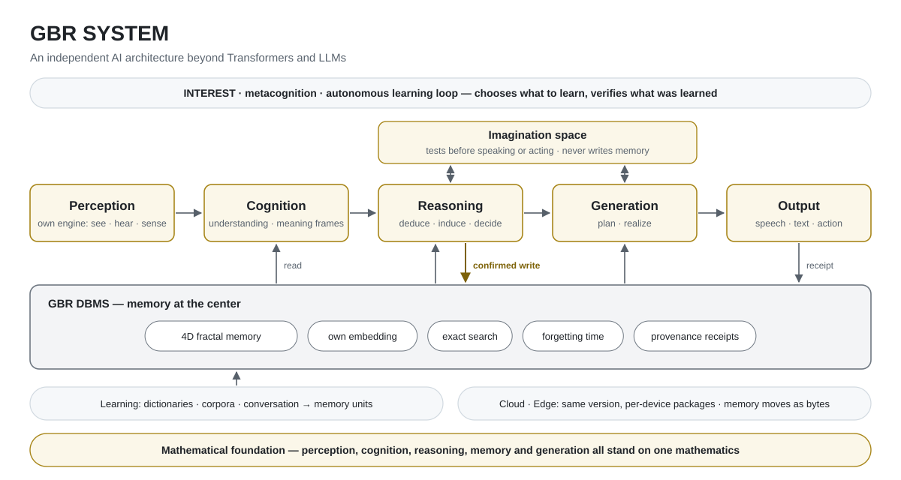

# GBR

## An independent AI architecture beyond Transformers and LLMs

[한국어](README.md)

GBR SYSTEM is an independently designed AI architecture that moves beyond the Transformer and LLMs.

GBR's reasoning engine solved all 10,000 puzzles (10,000 / 10,000, 0 wrong) drawn, by a rule fixed before any result, from the public test split of Sudoku-Extreme, an ultra-hard Sudoku dataset. The board rules it used were counted from the answer examples of the training split (with the first 81 answers they already match the standard rules), and it solved each puzzle in one attempt, with no guessing or backtracking. It also solved all 726 standard Sudoku puzzles taken from outside that dataset. This repository publishes an answer certificate for every puzzle, and a checker.

- GBR reasons over memory by deduction and induction. Before speaking or acting, it tests in an imagination space first: with evidence it answers, when the evidence is split it asks back, and without evidence it says it does not know.
- Perception, cognition, reasoning, memory and generation all stand on one new mathematical framework: our own mathematics, built to resolve long-standing problems of discrete updates and variational operations.
- Memory is a 4D fractal memory on our own DBMS. The same form repeats at every size, from a single memory to groups and groups of groups, so as memory grows only the parts needed are found and read, exactly. Our embedding is our own as well, not borrowed.
- We implemented our own perception engine, with no external libraries such as OpenCV, and engines for judgment and generation.
- We are designing and developing an active foundation we call INTEREST, together with metacognition and an autonomous learning loop.

GBR runs on low power and modest hardware. We have confirmed that it currently runs on a single NVIDIA Jetson Orin Nano Super with 8 GB of memory, with no external server. You can watch the demo on [YouTube](https://youtu.be/3SpQAy4sbB0).

GBR is still in development. It has not learned much data yet, so it is not yet as fluent as LLMs or as striking at generation, but it clearly works. It is built in Korea and has so far learned only numbers and Korean.

GBR aims to be a sovereign AI that does not depend on existing architectures or external resources.

## Architecture

<picture>
  <source media="(prefers-color-scheme: dark)" srcset="figs/gbr-architecture-en-dark.svg">
  
</picture>

| | Weight-based language model | GBR |
|---|---|---|
| Reasoning | Continues text token by token | Deduction and induction over memory, tested before answering |
| Where knowledge is stored | Spread across trained weights | Versioned memory units |
| State per step | A context window that grows with the conversation, up to a limit | A fixed-size dialogue state, plus memory queried on demand |
| How learned results are applied and changed | Retraining or fine-tuning | Publishing, correcting and retracting memory units |

## Sudoku results

Sudoku results from GBR's reasoning engine, with proofs. The engine was run directly; this is not a full-system-path score.

| Item | Details |
|---|---|
| Dataset | The test split of `sapientinc/sudoku-extreme` on Hugging Face (422,786 puzzles) |
| Puzzles | 10,000 puzzles drawn by a rule fixed before the run (hash order of puzzle numbers) · rule and list in [`results/sudoku/`](results/sudoku/README.md#sudoku-10000-puzzle-result--answer-certificates--checker) |
| Conditions | GBR's reasoning engine, run directly · one attempt per puzzle · no guessing, no backtracking (the solver never carries on from a candidate assumed to be right). The 10,000 solving-process certificates were checked internally with independent checkers and drat-trim, and are not published. |
| Board rules | The board rules (which cells may not hold the same digit) are counted from the answer examples of the training split (`train.csv`). With the first 81 answers the counted rules already equal the standard rules; on the public path the counted rules are checked against the standard ones, and the engine does not solve if they differ. Solving the 10,000 puzzles again with the counted rules gave the same answers and certificates, byte for byte. This applies to standard 9×9 only. |
| Results | 10,000 / 10,000 · 0 wrong answers · 7,379 / 7,379 on puzzles never seen in development · every difficulty band fully solved (all 115 puzzles of the hardest band were seen in development) · per-band table in [`results/sudoku/`](results/sudoku/README.md#sudoku-10000-puzzle-result--answer-certificates--checker) |
| Full-system check | The first 100 puzzles of the same list were also solved through the full system path, with the same answers as the engine |
| Outside the dataset | 726 standard 9×9 puzzles, taken from four public lists by a rule fixed before the run, were solved by the same engine under the same conditions: 726 / 726, with every certificate verified by the checker and drat-trim. Of these, the 611 confirmed to lie outside the dataset (compared by text and up to Sudoku symmetry) were solved 611 / 611, AI Escargot included. Anyone can re-check the certificates; that the same engine solved them under the same conditions was checked internally. Table and certificates in [`results/sudoku/outside_dataset_726/`](results/sudoku/outside_dataset_726/) |
| Proof | An answer certificate for every puzzle is in [`results/sudoku/certificates/`](results/sudoku/certificates/). Each certificate shows that the answer is the unique solution (standard Sudoku CNF + RUP lemmas · DRAT text). The public prover that builds the certificates is given only the puzzle and the reasoning engine's answer, and the checker compares the result with the dataset answer. A generic checker anyone can run is in [`results/sudoku/verify/sudoku-rup-check/`](results/sudoku/verify/sudoku-rup-check/), and the public prover's source in [`results/sudoku/verify/sudoku-rup-prover/`](results/sudoku/verify/sudoku-rup-prover/). All 10,000 were also verified with the external checker drat-trim (public source, commit 2e3b2dc0): VERIFIED 10,000, NOT VERIFIED 0. Per-puzzle answer hashes let you compare each answer with the dataset. |
| Per-puzzle results | [`results/sudoku/`](results/sudoku/README.md#sudoku-10000-puzzle-result--answer-certificates--checker) (the result tables carry no puzzle text or grids) |

### Test environment

| Item | Details |
|---|---|
| Machine | One desktop-class PC: Intel Core i5-13500 (14 cores, 20 threads) · 64 GB memory · NVMe SSD |
| GPU | Not used (CPU only) |
| OS | Ubuntu 24.04 LTS |
| Solving | GBR's reasoning engine · one attempt per puzzle · 10 puzzles at a time · 10,000 puzzles in 1 h 56 min (6,939 s) · at most about 2.1 GB of memory per solving process |
| Checking | Certificates built in 159 s for the 10,000 (16 batches at once) · the public checker (Rust 1.96, standard library only), 10.6 s for the 10,000 · the external checker drat-trim (public source, commit 2e3b2dc0, gcc 13.3), 88 s for the 10,000, 16 at a time |
| Data | `sapientinc/sudoku-extreme` test.csv (sha256 `a2fd52aea23d331d5b4ee723c856236e838a9fb9a70e66f4e0e0cf26c338c6a8`) |

Check it yourself (building the checker needs Rust 1.85 or later; we built it with 1.96):

```bash
cd results/sudoku
# download the test file of the dataset (sapientinc/sudoku-extreme) and check its sha256 (79,360,390 bytes)
curl -L -o test.csv https://huggingface.co/datasets/sapientinc/sudoku-extreme/resolve/main/test.csv
echo "a2fd52aea23d331d5b4ee723c856236e838a9fb9a70e66f4e0e0cf26c338c6a8  test.csv" | sha256sum -c
cargo build --release --manifest-path verify/sudoku-rup-check/Cargo.toml
mkdir certs && tar -xzf certificates/sudoku_10k_certificates.tar.gz -C certs
verify/sudoku-rup-check/target/release/sudoku-rup-check dataset test.csv certs/proofs
# the checker counts only the certificate files present: the last line should read TOTAL boards=10000 verified=10000 open=0 failed=0
```

> Result: 10,000 / 10,000 · 0 wrong · all 10,000 answer certificates pass the checker (and the external checker drat-trim) · 7,379 / 7,379 on puzzles never seen in development · 726 / 726 standard puzzles from outside the dataset (611 / 611 confirmed outside). This is a reasoning-engine result, not a full-system-path score.

For reference: the HRM paper (arXiv:2506.21734, 2025) reports that on Sudoku-Extreme "state-of-the-art CoT methods completely fail (0% accuracy)".

## License

This repository is licensed under the [Apache License 2.0](LICENSE). The few well-known Sudoku puzzles included as test data in the checker and prover belong to their respective sources.

## Learn more

- Demo video: [YouTube](https://youtu.be/3SpQAy4sbB0)
- Website: [zigulabs.com](https://www.zigulabs.com)
- Contact: [agent@zigulabs.com](mailto:agent@zigulabs.com)

© 2026 ZIGU LABS, Inc.
